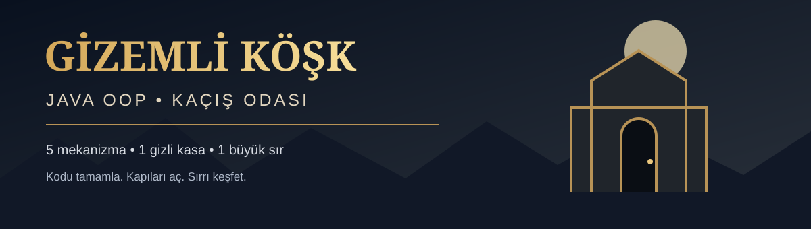

<div align="center">



# 🔐 Gizemli Köşk: Son Kasa

**Java Swing ile Nesne Yönelimli Programlama Laboratuvarı**

   

*Bir anahtar, beş gizem ve kilitli bir kasa…*

</div>

---

> **Bir köşkün kapısındasın.** İçeride beş farklı mekanizma ve son odada kilitli bir kasa var. Her kapıyı açmanın yolu Java kodundan geçiyor. Eksik sınıfları tamamla, ipuçlarını topla ve kasanın sırrını çöz.

## 🎯 Bu etkinlikte neler öğreneceksin?

Yapıcı metotlar (**constructor**), `this`, `this(...)`, erişim belirleyicileri (`private`), **getter/setter**, `static`, `final` ve metot çağrıları üzerine uygulama yapacaksın.

**Hedef:** Sadece çalışan kod yazmak değil; yazdığın kodun bir nesnenin davranışını nasıl değiştirdiğini gözlemlemek.

## 🗺️ Macera haritası

```text
🏚️ KÖŞKÜN DIŞ KAPISI
   │  Anahtar.java — constructor / this
   ▼
🚪 İÇ KAPI
   │  Pusula.java — private / getter / setter
   ▼
🗿 MUHAFIZLAR ODASI
   │  Muhafiz.java — static
   ▼
📚 ESKİ KİTAPLIK
   │  NotCozucu.java — metot çağrısı
   ▼
🧱 GİZLİ DUVAR
   │  Kurallar.java — final
   ▼
🔒 SON KASA
   └─ Önceki odaların ipuçlarıyla şifreyi çöz!
```

## 🧰 Gereksinimler

- **JDK 8 veya üzeri** (JRE tek başına yeterli değildir; `javac` gerekir).
- Windows, macOS veya Linux.
- VS Code, IntelliJ IDEA ya da herhangi bir metin editörü.
- İnternet bağlantısı veya ek Java kütüphanesi gerekmez.

JDK kurulumunu kontrol et:

```bash
java -version
javac -version
```

## 🚀 Adım adım çalıştırma

### 1. Projeyi indir

GitHub sayfasında **Code → Download ZIP** seçeneğini kullan veya projeyi klonla. ZIP'i çıkart ve içinde `src`, `calistir.sh` ve `calistir.bat` bulunan **proje klasörünü** aç.

### 2. Terminali proje klasöründe aç

VS Code kullanıyorsan **File → Open Folder** ile proje klasörünü aç, ardından **Terminal → New Terminal** seç.

### 3. Oyunu başlat

**macOS / Linux**

```bash
bash calistir.sh
```

**Windows**

```bat
calistir.bat
```

**Alternatif: Her sistemde elle derleme**

```bash
mkdir -p out
javac -encoding UTF-8 -d out src/*.java
java -cp out Main
```

> **Dikkat:** VS Code'daki **Run Code** ile seçili satırları çalıştırma. `tempCodeRunnerFile.java` gibi geçici dosyalar Java derleme hatası oluşturabilir. Yukarıdaki terminal komutlarını kullan.

### 4. Görevleri tamamla ve yeniden çalıştır

`src` klasöründeki **GÖREV** yorumlarını bul. Her bölümün kodunu tamamladıktan sonra dosyayı kaydet ve `bash calistir.sh` / `calistir.bat` ile **yeniden derleyip başlat**. Yeni odaya geçebilmek için mekanizmayı oyunda dene.

## 🧩 Görev rehberi

| Aşama | Dosya | Kazanım | Beklenen davranış |
|:--|:--|:--|:--|
| 01 · Dış kapı | `Anahtar.java` | Yapıcılar, `this`, `this(...)` | Anahtar mekanizması çalışır |
| 02 · İç kapı | `Pusula.java` | `private`, getter/setter | Yön mekanizması doğru tepki verir |
| 03 · Muhafızlar | `Muhafiz.java` | `static` alan ve metot | Ortak sayaç doğru çalışır |
| 04 · Kitaplık | `NotCozucu.java` | Metot çağrısı, parametreler | Şifreli not çözümlenir |
| 05 · Gizli duvar | `Kurallar.java` | `final` sabit | Duvar mekanizması etkinleşir |
| 06 · Son kasa | Oyun ekranı | İpuçlarını birleştirme | Kasa açılır, “YOKLAMAYA İMZA AT!” mesajı görünür |

### 🧠 Nasıl ilerlemelisin?

1. Oyun ekranındaki sahneyi ve ipucunu dikkatlice oku.
2. İlgili Java dosyasını açıp **GÖREV** yorumunu bul.
3. Yalnızca istenen kodu tamamla ve kaydet.
4. Programı yeniden derleyip başlat.
5. Oyundaki mekanizmayı dene ve sonraki aşamaya ilerle.

**Düzenlememen gereken dosyalar:** `Main.java`, `KasaPaneli.java` ve `Sifreleyici.java`. Bunlar oyunun altyapısını oluşturur.

## ⏱️ Önerilen laboratuvar akışı

| Etkinlik | Süre |
|---|---:|
| Hikâye, kurallar ve kurulum | 10 dk |
| Dış kapı + iç kapı | 15 dk |
| Muhafızlar + kitaplık | 15 dk |
| Gizli duvar + son kasa | 15 dk |
| Değerlendirme ve soru-cevap | 10 dk |
| **Toplam** | **65 dk** |

## 📂 Proje yapısı

```text
Gizemli_Kosk_Baslangic/
├── assets/
│   └── banner.svg         # GitHub README kapak görseli
├── src/
│   ├── Main.java          # Uygulama başlangıcı
│   ├── KasaPaneli.java    # Swing oyun ekranı
│   ├── Sifreleyici.java    # Şifreleme altyapısı
│   ├── Anahtar.java       # 1. görev
│   ├── Pusula.java        # 2. görev
│   ├── Muhafiz.java       # 3. görev
│   ├── NotCozucu.java     # 4. görev
│   └── Kurallar.java      # 5. görev
├── calistir.sh            # macOS / Linux
├── calistir.bat           # Windows
└── README.md
```

## 🛠️ Sık karşılaşılan sorunlar

<details>
<summary><strong>“javac: command not found” hatası alıyorum</strong></summary>

JDK kurulu olmayabilir veya sistem PATH ayarında bulunmayabilir. `javac -version` ile kontrol et.

</details>

<details>
<summary><strong>tempCodeRunnerFile.java hatası çıkıyor</strong></summary>

Seçili bir kod parçasını Code Runner ile çalıştırma. Geçici dosyayı kapat ve proje klasöründe terminalden `bash calistir.sh` ya da `calistir.bat` komutunu kullan.

</details>

<details>
<summary><strong>Kodu düzelttim ama kapı açılmıyor</strong></summary>

Dosyayı kaydettiğinden emin ol. Uygulamayı kapat, yeniden derle ve başlat. Ayrıca oyunda ilgili mekanizmayı tekrar dene.

</details>

<details>
<summary><strong>Türkçe karakterler bozuk görünüyor</strong></summary>

Dosyaları UTF-8 olarak kaydet. Derleme komutunda `-encoding UTF-8` parametresi bulunuyor.

</details>

---

<div align="center">

### 🗝️ Kapıların anahtarı, yazdığın kodda saklı.

*Java OOP • Uygulamalı Laboratuvar Etkinliği*

</div>
